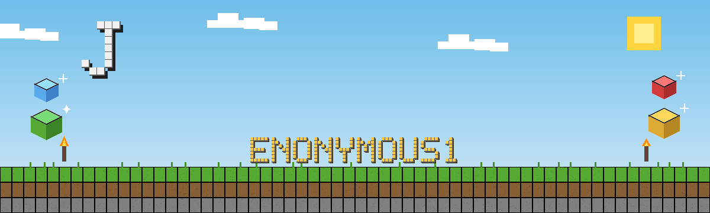

<div align="center">

# Hi there, I'm Justin 👋

[](https://git.io/typing-svg)


**I build automation and full-stack tools for real operations, and I ship them tested, documented, and CI-green — not as demos.**

IT Manager with an AS & BS in Computer Science (Full Sail). I blend hands-on engineering with leadership: pricing and vendor data, message and photo archives, video and market-data pipelines, Android apps, and the homelab they all run on.

[](https://justinlyons.dev)
[](https://www.linkedin.com/in/justinplyons/)

</div>

---

## 🚀 About Me

- 💼 **IT Manager** passionate about technology, infrastructure, and people — and about removing the manual work in between.
- 🎓 AS & BS in Computer Science, with weight in Mobile Application Development.
- 🛠️ Builds automation and full-stack tools for real operations: pricing and vendor data, message and photo archives, video and market-data pipelines.
- 🧪 Ships tested, documented tools with CI. The numbers in Featured Projects below are from the repos themselves, not marketing copy.
- 🏠 Runs a homelab stack (Unraid, Docker) for media, backups, and automation, plus functional 3D printing on a Bambu Lab P1S.
- 📍 Fredericksburg / Spotsylvania, Virginia. See the work live at [justinlyons.dev](https://justinlyons.dev).

---

## 🛠️ Skills & Tools

### Languages

[](https://skillicons.dev)

### Frameworks, Data & Platforms

<p align="left">
  
  
  
  
  
  
  
</p>

### Infrastructure & Homelab

<p align="left">
  
  
  
  
  
  
</p>

> Leadership, in one line: Agile delivery, team building, project management, and mentorship — the work above is what that looks like in practice.

---

## 🌟 Featured Projects

<p align="center">
  <a href="https://github.com/enonymous1/sms-toolkit"></a>
  <a href="https://github.com/enonymous1/voxel-portfolio"></a>
</p>

| Project | What it does | Proof |
| :--- | :--- | :--- |
| **[repo-sync](https://github.com/enonymous1/repo-sync)** | Dozens of repos on GitHub, dozens of folders on disk — tells you which is which, with metadata reports and Markdown export. | Python, GitHub API · 132 tests |
| **[sms-toolkit](https://github.com/enonymous1/sms-toolkit)** | Your backup app copies everything, every day. This keeps only what's new — deduplicated SMS/MMS archives in a chat-style viewer. | 1,146,266 items processed, 99.78% duplicates dropped · 184/184 tests |
| **[gas-auditor](https://github.com/enonymous1/gas-auditor)** | Google hides some of your scripts from Drive. This finds them anyway — inventory and audit for Google Apps Script projects. | Python, Flask, Google APIs · CLI + dashboard + Apps Script app |
| **[google_maps_poi](https://github.com/enonymous1/google_maps_poi)** | Drop a marker, add a photo and category, search, edit, get directions. A POI is a real database row, not EXIF hidden in a JPEG. | Kotlin, Compose, Room, Maps SDK |
| **[video-optimizer-suite](https://github.com/enonymous1/video-optimizer-suite)** | HEVC video-library optimizer: scan, convert, verify, then replace — only if verified. DVD and camcorder ingest included. | Python, ffmpeg/x265, SQLite, Flask dashboard |
| **[voxel-portfolio](https://github.com/enonymous1/voxel-portfolio)** | A portfolio you walk through: a voxel world in the browser, with real projects to open. | TypeScript, Svelte 5, Three.js |

More, in the same spirit: **[photo-stitcher](https://github.com/enonymous1/photo-stitcher)** (FastFoto scan wizard, with a real demo GIF in the repo), **[gsa-vendor-toolkit](https://github.com/enonymous1/gsa-vendor-toolkit)** (GSA vendor price-list pipeline), and **[kalshi-recorder](https://github.com/enonymous1/kalshi-recorder)** (Kalshi order-book recorder to Parquet). Full list on [justinlyons.dev](https://justinlyons.dev).

---

## 📈 This month in code


<!--START_SECTION:stats-->
As of Oct 31, 2026: **74 public repos counted** (2 forks excluded) · **7,551,534 bytes of code** across **17 languages**. Shares below are share of code by bytes — not share of repos.

```
▁▁▁▁▁▁▁▁▁▁▁▁▁▁▁▁▁▁▁▁▁▁▃▂█▄▅▃▂▁
Oct 02 - Oct 31, 2026 · 128 public events · busiest day Oct 26 (46)
```

#### Top languages

```
Python      ██████████           50.2%  3,792,367 bytes · 40 repos
JavaScript  ██████               28.3%  2,136,461 bytes · 14 repos
Kotlin      █                     7.3%  554,218 bytes · 14 repos
HTML        █                     3.6%  270,079 bytes · 16 repos
PowerShell  █                     2.5%  189,257 bytes · 4 repos
CSS         █                     2.3%  175,426 bytes · 12 repos
Swift       █                     2.1%  157,555 bytes · 5 repos
C#          █                     1.3%  100,385 bytes · 3 repos
TypeScript  █                     1.1%  80,127 bytes · 2 repos
Svelte      █                     0.5%  34,583 bytes · 1 repo
Other       █                     0.8%  61,076 bytes · 10 repos
```
<!--END_SECTION:stats-->

<sub>Generated daily from GitHub's language-bytes API across all public non-fork repos. The Oct 29, 2026 clone audit (code files only, 5,475,378 bytes / 150,017 lines) cross-checked exact for 3 of 5 sampled repos, within 9% for jpl-dev (generated CSS) and 2% for voxel-portfolio. For contrast, by primary-language repo count: Python 30 repos, Kotlin 11, Swift 5, JavaScript 4 (of 60 repos with a detected primary language).</sub>

---

## ⚙️ Behind the Scenes: Homelab & Maker Stack

Beyond code, I maintain a home server environment running **Unraid** and **Docker** for media, backups, and automation. I'm also heavily involved in functional 3D printing using a **Bambu Lab P1S** to design parametric models and custom organizers — see **[openscad-toolkit](https://github.com/enonymous1/openscad-toolkit)** for the calibration prints and the sliding-lid box that actually fits.

---

## 📡 Recent Activity

<!--START_SECTION:activity-->
- 📦 Pushed to [`enonymous1/jpl-dev`](https://github.com/enonymous1/jpl-dev) on `main` — Oct 29, 2026
- 🔀 Merged PR [a pull request](https://github.com/skybrush-io/skybrush-server) in [`skybrush-io/skybrush-server`](https://github.com/skybrush-io/skybrush-server) — Oct 30, 2026
- 🔀 Opened PR [a pull request](https://github.com/skybrush-io/skybrush-server) in [`skybrush-io/skybrush-server`](https://github.com/skybrush-io/skybrush-server) — Oct 30, 2026
- 🐛 Opened issue [Virtual UAV stuck in LANDING after a show ends, never flips to LANDED](https://github.com/skybrush-io/skybrush-server/issues/45) in [`skybrush-io/skybrush-server`](https://github.com/skybrush-io/skybrush-server) — Oct 30, 2026
- 🍴 Forked [`enonymous1/skybrush-server`](https://github.com/enonymous1/skybrush-server) — Oct 30, 2026
<!--END_SECTION:activity-->

---

## 📫 Connect With Me

[](https://www.linkedin.com/in/justinplyons/)
[](https://justinlyons.dev)

---

> _"Code is like humor. When you have to explain it, it's bad."_  
> — Cory House


